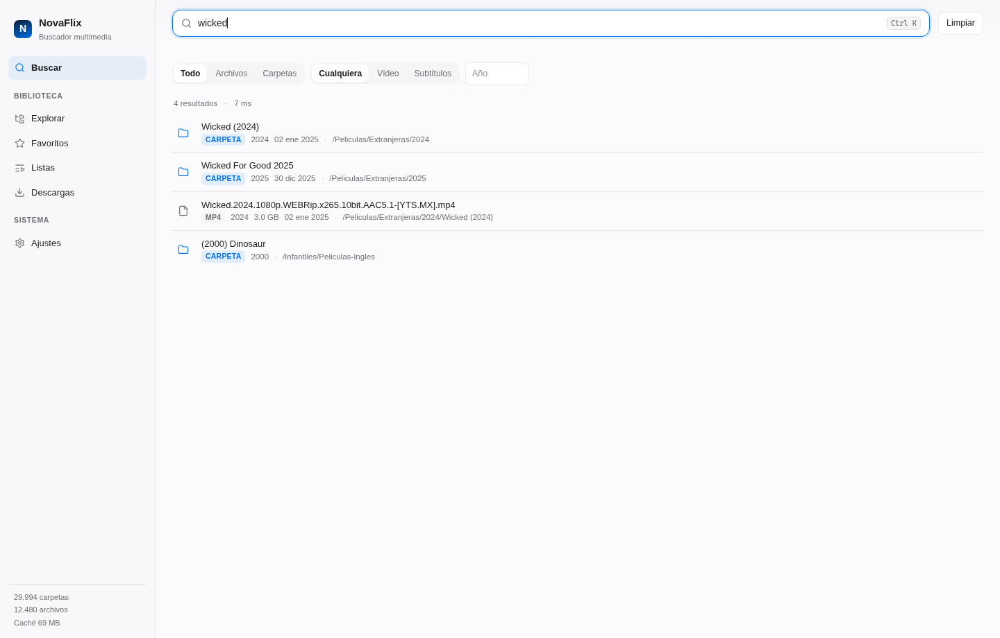
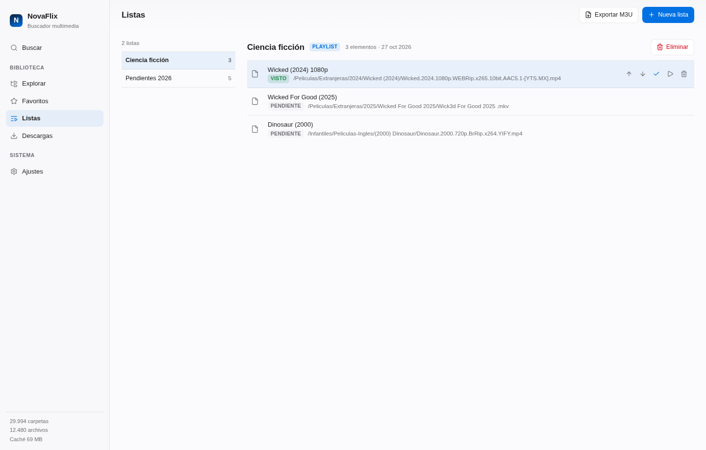
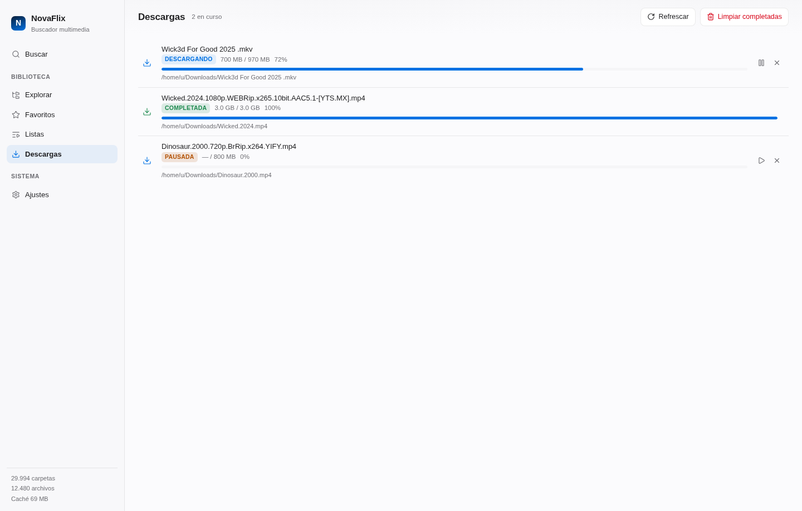
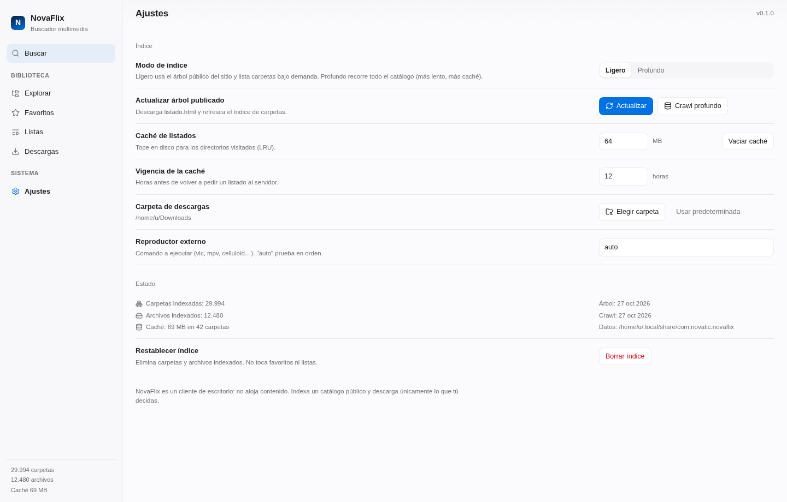

<p align="center">
  
</p>

<h1 align="center">NovaFlix</h1>

<p align="center">
  Buscador de escritorio para catálogos multimedia públicos.<br/>
  Búsqueda instantánea, favoritos, listas y descargas con reanudación.
</p>

<p align="center">
  <a href="../../releases"></a>
  <a href="LICENSE"></a>
  <a href="../../actions/workflows/release.yml"></a>
  
</p>

---

**Sitio web:** <https://novatic-cu.github.io/NovaFlix/> · **Repositorios:** [APT](https://novatic-cu.github.io/NovaFlix/apt/) · [pacman](https://novatic-cu.github.io/NovaFlix/pacman/)

NovaFlix indexa un catálogo público en una caché local desechable y ofrece una interfaz de escritorio rápida para encontrar, guardar y descargar contenido. No aloja contenido ni requiere cuenta.

## Capturas

| Buscar | Listas |
|---|---|
|  |  |

| Descargas | Ajustes |
|---|---|
|  |  |

> Las capturas de `docs/screenshots/` son de referencia. Sustitúyelas por las tuyas manteniendo los nombres.

## Funciones

- **Búsqueda FTS5** con prefijos y normalización leet: `Wick3d.For.Good.2025.1080p` se encuentra buscando `wicked`.
- **Índice ligero en ~1 s**: 30.000 carpetas desde el árbol publicado; los archivos se listan al abrir cada carpeta.
- **Crawl profundo opcional** para indexar también archivos sueltos.
- **Favoritos** por contenido y por carpeta, con etiqueta y nota.
- **Listas**: playlists ordenables y lista de "para ver" con estado *visto*.
- **Descargas** con cola, reanudación por `Range`, progreso en vivo y contadores por ruta.
- **Exportación M3U/M3U8** y reproducción con VLC/mpv/celluloid.
- **Tema claro/oscuro** automático, `prefers-reduced-motion`, `prefers-reduced-transparency` y `prefers-contrast`.

## Instalación

### Debian / Ubuntu · repositorio APT

```bash
curl -fsSL https://novatic-cu.github.io/NovaFlix/apt/novaflix.gpg \
  | sudo gpg --dearmor -o /usr/share/keyrings/novaflix.gpg
echo "deb [signed-by=/usr/share/keyrings/novaflix.gpg] https://novatic-cu.github.io/NovaFlix/apt stable main" \
  | sudo tee /etc/apt/sources.list.d/novaflix.list
sudo apt update && sudo apt install nova-flix
```

Actualizar: `sudo apt update && sudo apt upgrade nova-flix`. El paquete APT se llama `nova-flix`; el binario instalado es `novaflix`.

<details>
<summary>Clave de firma del repositorio</summary>

Fingerprint: `F005 E863 F53A 70D6 0447  9A36 9FE8 FBEF 7C21 10F0`
</details>

### Debian / Ubuntu · paquete suelto

```bash
curl -LO https://github.com/novatic-cu/NovaFlix/releases/latest/download/NovaFlix_0.1.0_amd64.deb
sudo apt install ./NovaFlix_0.1.0_amd64.deb
```

### Arch Linux · repositorio pacman (recomendado)

```bash
# pacman-key solo acepta ficheros locales: descarga la clave primero
curl -fsSL https://novatic-cu.github.io/NovaFlix/pacman/x86_64/novaflix.gpg -o /tmp/novaflix.gpg
sudo pacman-key --add /tmp/novaflix.gpg
sudo pacman-key --lsign-key F005E863F53A70D604479A369FE8FBEF7C2110F0

# añade a /etc/pacman.conf
[novaflix]
SigLevel = Required DatabaseOptional
Server = https://novatic-cu.github.io/NovaFlix/pacman/$arch

sudo pacman -Sy novaflix-bin
```

Con el repositorio configurado, `paru -S novaflix-bin` también resuelve el paquete sin tocar AUR.

### Arch Linux · AUR

`aur.yml` mantiene `novaflix-bin` actualizado en cada release. El registro de cuentas de AUR está cerrado temporalmente, así que la primera publicación sigue pendiente; mientras tanto usa el repositorio pacman de arriba.

### Arch Linux · paquete suelto

```bash
paru -U https://github.com/novatic-cu/NovaFlix/releases/latest/download/novaflix-bin-0.1.0-1-x86_64.pkg.tar.zst
```

### Linux · AppImage

```bash
curl -LO https://github.com/novatic-cu/NovaFlix/releases/latest/download/NovaFlix_0.1.0_amd64.AppImage
chmod +x NovaFlix_0.1.0_amd64.AppImage
./NovaFlix_0.1.0_amd64.AppImage
```

### Windows

```powershell
winget install Novatic.NovaFlix
```

Si el manifiesto aún no está publicado en winget, descarga `NovaFlix_0.1.0_x64-setup.exe` (NSIS) o el `.msi` desde [Releases](../../releases). Requiere WebView2 (incluido en Windows 10/11).

### macOS

```bash
brew install --cask novatic-cu/tap/novaflix
```

O descarga el `.dmg` de [Releases](../../releases). Las builds no están firmadas ni notarizadas: la primera vez, clic derecho → *Abrir*.


## Desarrollo

Requisitos: Node 24, pnpm 12, Rust 1.77+, WebKitGTK 4.1 en Linux.

```bash
pnpm install
pnpm tauri dev
```

Compilar instaladores:

```bash
pnpm tauri build --bundles deb        # Debian/Ubuntu
pnpm tauri build --bundles appimage   # AppImage
pnpm tauri build --bundles nsis,msi   # Windows
pnpm tauri build --bundles dmg,app    # macOS
```

## Arquitectura

```
src/                     React 19 + TypeScript
  components/            Sidebar, Sheet, ItemRow, Toasts, AddToList
  screens/               Search, Browse, Favorites, Lists, Downloads, Settings
  lib/                   IPC tipado, acciones, formato, tipos
src-tauri/src/
  commands.rs            superficie IPC
  index.rs               bootstrap, FTS, browse, crawl
  db.rs                  esquema SQLite y helpers
  catalog.rs             cliente HTTP + parser del autoindex
  downloads.rs           cola con Range/resume y eventos
  library.rs             favoritos, listas, contadores, M3U, reproductor
  norm.rs                normalización leet + extracción de año
```

Dos bases SQLite:

| Base | Contenido | Tamaño | Vida |
|---|---|---|---|
| `cache.db` | índice de rutas y listados visitados | 6–90 MB | desechable |
| `app.db` | favoritos, listas, contadores, ajustes | < 5 MB | respaldo |

Rutas: Linux `~/.local/share/com.novatic.novaflix/` · Windows `%APPDATA%\com.novatic.novaflix\`.

## Seguridad y privacidad

- Sin cuentas, sin telemetría, sin analytics.
- Host allowlist en el backend y CSP estricta en el webview.
- TLS verificado; descargas a `.part` con nombre saneado antes de renombrar.
- Las dependencias se actualizan con Dependabot y se analizan con CodeQL.

Para reportar vulnerabilidades: [SECURITY.md](SECURITY.md).

## Contribuir

Issues y pull requests son bienvenidos. Lee [CONTRIBUTING.md](CONTRIBUTING.md) y el [código de conducta](CODE_OF_CONDUCT.md).

## Licencia

**PolyForm Noncommercial 1.0.0**. Uso gratuito para fines personales, educativos, de investigación y para organizaciones sin ánimo de lucro. El uso comercial, la reventa o el servicio alojado requieren una licencia comercial: consulta [COMMERCIAL.md](COMMERCIAL.md).

NovaFlix no aloja ni redistribuye contenido; indexa un catálogo público y la descarga es responsabilidad del usuario.
