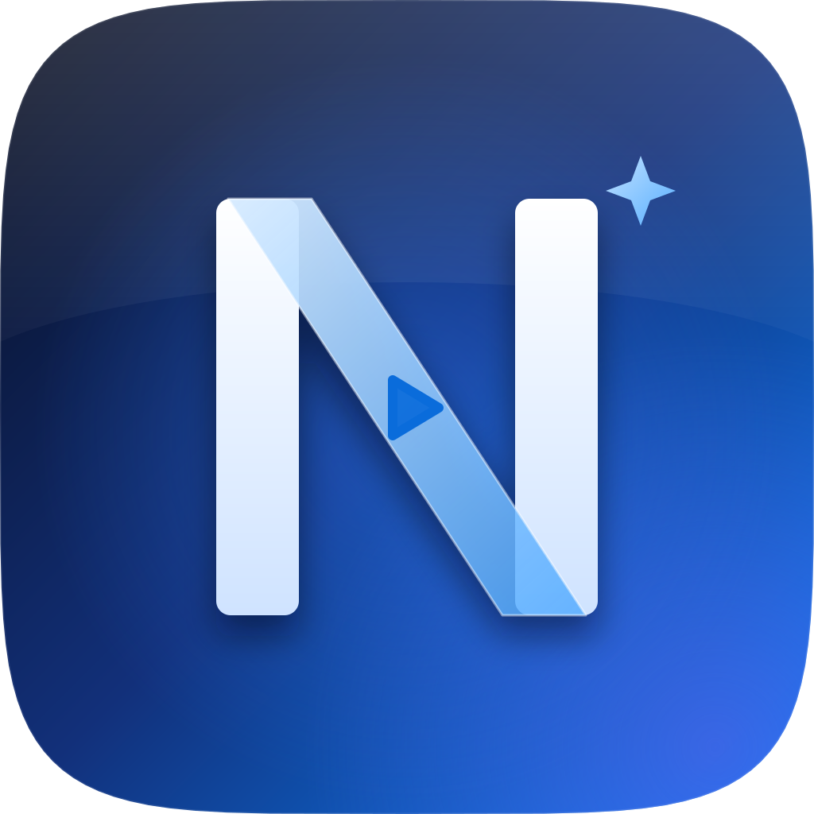
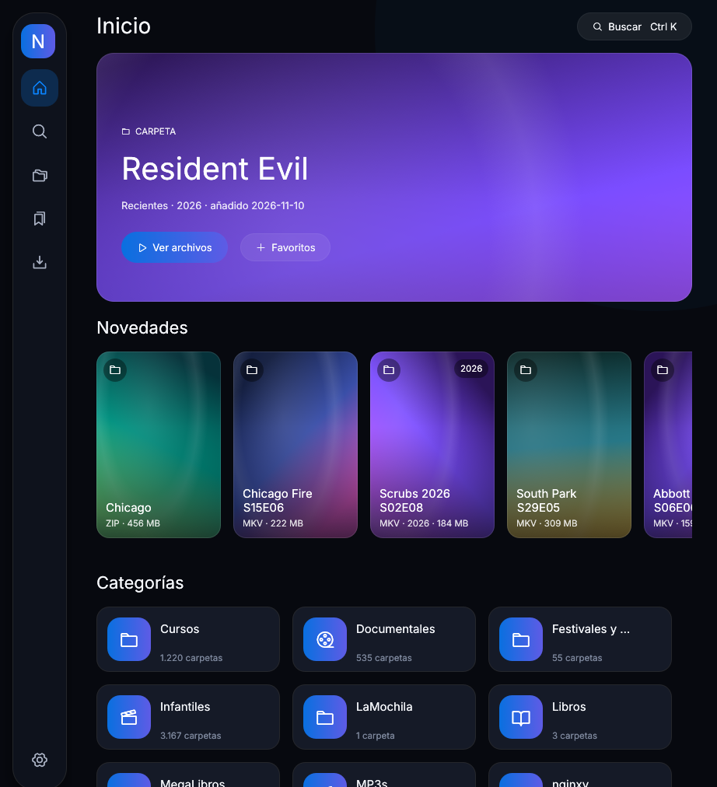
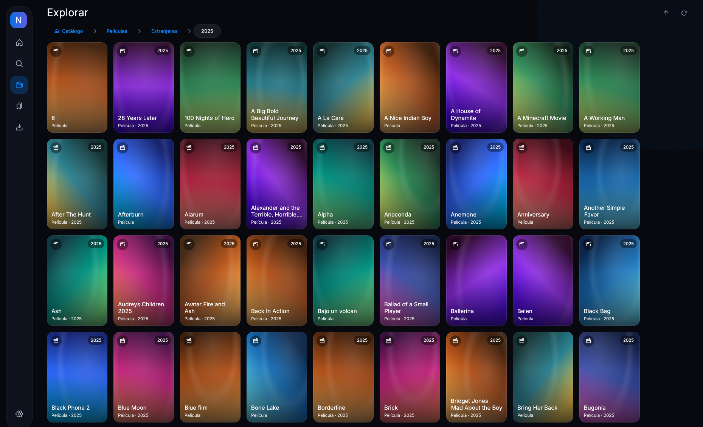
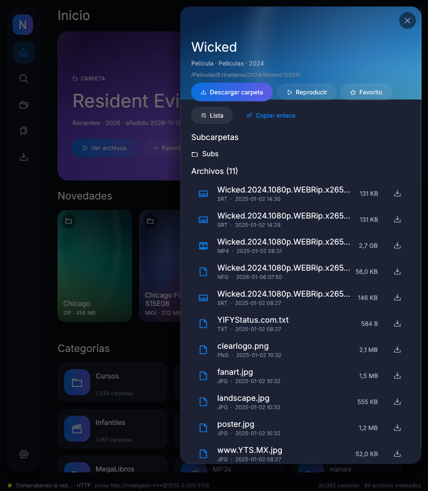
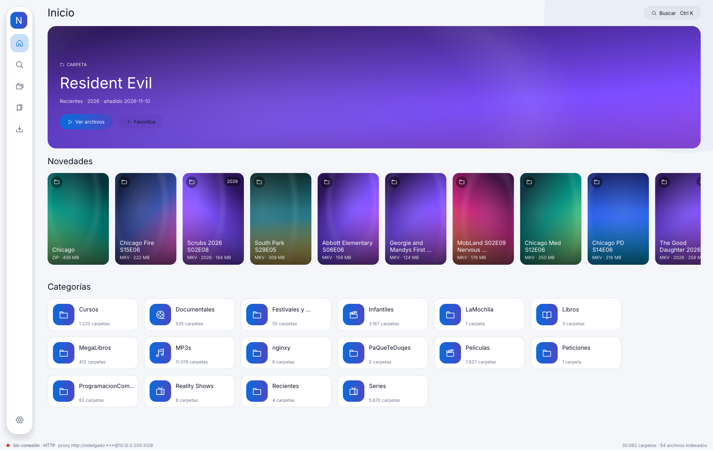

<p align="center">
  
</p>

<h1 align="center">NovaFlix</h1>

<p align="center">
  Explorador de escritorio, con estilo de app de streaming, para el catálogo de <a href="https://visuales.uclv.cu/">visuales.uclv.cu</a>.<br/>
  HTTP o FTP a tu elección, diagnóstico de red y descargas reanudables.
</p>

<p align="center">
  <a href="../../releases"></a>
  <a href="LICENSE"></a>
  <a href="../../actions/workflows/ci.yml"></a>
  
</p>

---

**Sitio web:** <https://novatic-cu.github.io/NovaFlix/>

> **NovaFlix 2 está en alpha** (2.0.0-alpha.2). Es una reescritura completa en Rust de la v1 (Tauri/React), que queda descontinuada y archivada en la rama [`v1`](../../tree/v1). Puede haber fallos; el instalador de Windows aún no se ha probado en equipos reales.

NovaFlix indexa el catálogo público en una caché local desechable y ofrece una interfaz nativa rápida para encontrar, guardar y descargar contenido. No aloja contenido ni requiere cuenta.

## Capturas

| Inicio | Explorar |
|---|---|
|  |  |

| Ficha de título | Tema claro |
|---|---|
|  |  |

## Funciones

- **Interfaz de streaming** («Nova Glass»): portada destacada, estanterías con pósters reales descubiertos en cada carpeta, categorías, contenido al azar y fichas por título. Esqueletos mientras cargan las imágenes.
- **HTTP o FTP a elección**: Automático, HTTP o FTP. Cliente FTP propio de solo lectura (`MLSD`/`LIST`, `SIZE`, `REST`, `RETR`) con soporte de proxy SOCKS5.
- **Diagnóstico de red** que prueba DNS, puerto 21, túnel `CONNECT` por el proxy y HTTPS, y explica el resultado en lenguaje llano. En Automático elige HTTP si FTP no es posible.
- **Búsqueda FTS5** con prefijos y normalización leet: `Wick3d.For.Good.2025.1080p` se encuentra buscando `wicked`.
- **Índice ligero**: ~30.000 carpetas desde el árbol publicado; los archivos se listan al abrir cada carpeta.
- **Descargas** con cola persistente, `.part`, reanudación (`Range`/`REST`), verificación de tamaño, límite de velocidad y carpetas completas.
- **Favoritos y listas**, exportación M3U y reproducción con VLC/mpv.
- **Tema oscuro/claro**, atajos de teclado y «reducir movimiento».
- **Migración automática** de los datos de la v1 (copia `app.db.v1.bak`).

## Instalación

Descarga desde [Releases](../../releases/tag/v2.0.0-alpha.2) y comprueba el fichero con `SHA256SUMS`.

### Debian / Ubuntu

```bash
curl -LO https://github.com/novatic-cu/NovaFlix/releases/download/v2.0.0-alpha.2/NovaFlix_2.0.0-alpha.2_amd64.deb
sudo apt install ./NovaFlix_2.0.0-alpha.2_amd64.deb
```

El paquete se llama `nova-flix`; el binario instalado es `novaflix`.

### Linux · AppImage

```bash
curl -LO https://github.com/novatic-cu/NovaFlix/releases/download/v2.0.0-alpha.2/NovaFlix_2.0.0-alpha.2_amd64.AppImage
chmod +x NovaFlix_2.0.0-alpha.2_amd64.AppImage
./NovaFlix_2.0.0-alpha.2_amd64.AppImage
```

### Linux · tarball (Arch y otras)

`novaflix-2.0.0-alpha.2-x86_64.tar.gz` contiene el binario, el `.desktop` y los iconos. En Arch, el paquete `novaflix-bin` solo se publica en las versiones estables.

### Windows

Descarga `NovaFlix_2.0.0-alpha.2_x64-setup.exe` y ejecútalo (Windows 10/11, 64 bits). No requiere WebView2. El instalador no está firmado, así que SmartScreen puede avisar la primera vez. El `.msi` llegará con la primera versión estable.

### Repositorios APT y pacman

Publican solo versiones **estables**. Hoy contienen la v1; la v2 llegará con su primera versión estable. Detalles en el [sitio](https://novatic-cu.github.io/NovaFlix/).

## Desarrollo

Requisitos: Rust ≥ 1.95. En Linux, cabeceras de X11/Wayland y OpenGL (ver [CONTRIBUTING.md](CONTRIBUTING.md)).

```bash
cargo run -p novaflix                     # aplicación
cargo test --workspace                    # pruebas
cargo clippy --workspace --all-targets -- -D warnings
NOVAFLIX_DATA_DIR=/tmp/nf cargo run -p novaflix   # datos aislados
```

Instaladores: `cargo install cargo-packager` y `cargo packager --release` desde `crates/novaflix-app` (ver [`specs/001-novaflix-v2/release-and-ci.md`](specs/001-novaflix-v2/release-and-ci.md)).

## Arquitectura

```
crates/novaflix-core/   biblioteca sin interfaz
  transport/            HTTP (reqwest), FTP propio, diagnóstico de red
  catalog.rs index.rs   parser de listados, índice FTS5
  downloads.rs          cola con reanudación
  library.rs posters.rs favoritos y listas, descubrimiento de pósters
  migrate.rs            migración desde la v1
crates/novaflix-app/    aplicación egui/eframe
  screens/              inicio, buscar, explorar, ficha, biblioteca, descargas, ajustes
specs/001-novaflix-v2/  especificación (Spec-Driven Development)
docs/adr/               decisiones de arquitectura
```

La aplicación y el núcleo se comunican por métodos de `Core` y un canal de eventos. Datos en `~/.local/share/com.novatic.novaflix/` (Linux) o `%APPDATA%\com.novatic.novaflix\` (Windows): `cache.db` (desechable) y `app.db` (favoritos, listas, ajustes).

## Seguridad y privacidad

- Sin cuentas, sin telemetría, sin analítica. Solo lectura: nunca modifica el servidor.
- TLS verificado; la contraseña del proxy solo vive en memoria; descargas a `.part` con nombre saneado.
- Dependencias vigiladas con `cargo-audit`, `cargo-deny`, CodeQL y Dependabot.

Vulnerabilidades: [SECURITY.md](SECURITY.md).

## Contribuir

Lee [CONTRIBUTING.md](CONTRIBUTING.md) y el [código de conducta](CODE_OF_CONDUCT.md). Todo cambio de comportamiento parte de la especificación en `specs/`.

## Licencia

**PolyForm Noncommercial 1.0.0**: gratis para uso personal, educativo, de investigación y organizaciones sin ánimo de lucro. El uso comercial requiere licencia: [COMMERCIAL.md](COMMERCIAL.md).

NovaFlix no aloja ni redistribuye contenido; la descarga es responsabilidad del usuario.
